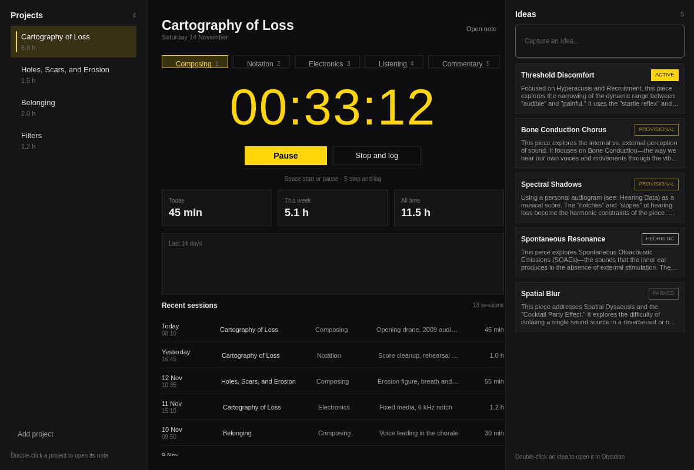

# cadence

Track time spent composing, and keep the ideas that arrive between teaching
days. cadence reads your Obsidian vault and appends to it — it never rewrites
existing notes.



## What it does

- **Sessions.** One timer, a project, and a mode. Stop and cadence asks what
  you did, then appends a row to `Dashboards/Composition Log.md`.
- **Ideas.** The idea notes already in `Composition Ideas/` sit in one column
  with their stage. Type a new idea and cadence creates the note; click a stage
  chip to move it along. Stage changes append to `Dashboards/Idea Triage.md`.
- **The week's shape.** Today, this week, all time, a 14-day bar chart, and the
  recent rows of the log, without opening Obsidian.

## Shortcuts

| Key | Action |
| :-- | :----- |
| `Space` | Start or pause the timer |
| `S` | Stop and log the session |
| `N` | Focus the idea field |
| `P` | Next project |
| `1`–`5` | Composing, Notation, Electronics, Listening, Commentary |
| `?` | Show the shortcut overlay |
| `Q` | Quit (cadence asks before discarding a running session) |

Single-key shortcuts are off while a text field has focus. Click a project to
select it, double-click to open its note in Obsidian. Double-click an idea to
open it too.

## The vault

cadence looks for the vault at `~/Obsidian-Vault`; set `CADENCE_VAULT` to point
somewhere else.

| Path | cadence's behaviour |
| :--- | :------------------ |
| `Dashboards/Composition Log.md` | Created on the first log, then appended one table row per session |
| `Dashboards/Idea Triage.md` | Created on the first stage change, then appended `- YYYY-MM-DD · [[Title]] · stage` |
| `Composition Ideas/*.md` | Read only, except new notes created from the idea field |
| `~/.local/share/cadence/projects.json` | Projects and their linked notes |

Existing idea frontmatter is never edited: the latest triage line wins, falling
back to the note's `status/…` tag. A new idea note gets the vault's frontmatter,
an H1, and an empty `## Concept` section.

## Command line

Every command is headless (no display needed) and `--json` prints machine-
readable output, so an agent can read and log without opening the window.

```sh
cadence log --minutes 25 --project "Cartography of Loss" --mode notation \
  --note "Re-voiced bars 12-18"
cadence sessions --days 14 --json
cadence ideas --json
cadence projects --json
cadence skill install        # prints the agent skill for this app
cadence open                 # the window
```

## Build, test, install

Requires Qt 6 (`qt6-base`, `qt6-declarative`) and, for the package, `pacman`.

```sh
./bin/build          # builds build/cadence
./bin/test           # runs the test suite
./bin/install        # builds the package and installs it with makepkg -fsi
./bin/install-user   # user-local install, no sudo (also honours PREFIX)
```

After installing, cadence appears in the launcher and honours the current
Omarchy theme: the accent colour updates live and the corner rounding follows
Hyprland.

## Translations

The UI follows Omarchy's language (`~/.config/omarchy/language`). Catalogs are
flat English-to-translation JSON, and the app switches live when the language
changes. Danish is included; add `src/i18n/<code>.json` and list it in
`src/resources.qrc`.

## Licence

MIT. The theme and translator follow Omarchy's Omacut app; see `LICENSE`.
